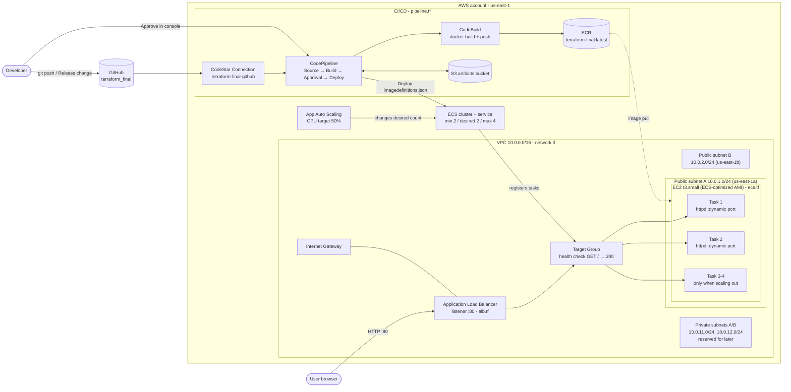

# terraform_final

A web page (`index.html` served by Apache `httpd`) running on **Amazon ECS (EC2)** behind an
**Application Load Balancer**, with **auto scaling (2 to 4 tasks)** and a **CI/CD pipeline**
(GitHub → CodeBuild → manual approval → ECS). All the infrastructure is written in **Terraform**.

📚 Official documentation behind every resource and decision: [REFERENCES.md](REFERENCES.md)

---

## 1. What we are building



**In words:**
1. You push to GitHub (or click **Release change**). CodePipeline downloads the repo.
2. **CodeBuild** builds the Docker image (`Dockerfile` + `index.html`) and pushes it to **ECR** with the tag `latest`.
3. The pipeline **stops** at the **Approval** stage until someone clicks **Approve** in the console.
4. The **Deploy** stage tells the **ECS service** to start new tasks with that image.
5. The tasks run on **one EC2 instance** (`t3.small`) that is part of the **ECS cluster**.
6. ECS registers every task in the **Target Group**. The **ALB** sends users' traffic only to tasks that pass the health check.
7. **Auto Scaling** keeps between **2 and 4 tasks**, depending on CPU usage.

---

## 2. Repository layout

```
.
├── Dockerfile          # FROM httpd + COPY index.html  (the app)
├── index.html          # the web page
├── CLAUDE.md           # project goal and rules
├── README.md           # this file
├── REFERENCES.md       # official HashiCorp + AWS docs for every decision
└── terraform/
    ├── main.tf         # INDEX: step-by-step map of all resources (read it first)
    ├── versions.tf     # AWS provider + remote state in S3
    ├── variables.tf    # region, names, repo, branch, instance type...
    ├── network.tf      # VPC, Internet Gateway, subnets, route tables
    ├── pipeline.tf     # GitHub connection, ECR, S3 artifacts, CodeBuild, CodePipeline (+IAM)
    ├── alb.tf          # Application Load Balancer, target group, listener
    ├── ecs.tf          # cluster, EC2 instance, task definition, service, auto scaling
    └── outputs.tf      # values printed after apply (app_url, ...)
```

Terraform reads **all** `.tf` files in `terraform/` as one configuration. The file names are
only for humans.

---

## 3. Creation order

Terraform does **not** follow the order of files or lines. It builds a **dependency graph**
from the references between resources: if B uses `A.id`, A is created first.
(See it yourself with `terraform graph`.)

| # | File | Resource | Depends on |
|---|------|----------|------------|
| 0 | `versions.tf` | provider + S3 backend `terraform-final-state` | - |
| 1.1 | `network.tf` | `aws_vpc.main` (10.0.0.0/16) | - |
| 1.2 | `network.tf` | `aws_internet_gateway.main` | 1.1 |
| 1.3 | `network.tf` | `aws_subnet.public_a/b`, `private_a/b` | 1.1 |
| 1.4 | `network.tf` | `aws_route_table.public` (0.0.0.0/0 → IGW), `private` | 1.2 |
| 1.5 | `network.tf` | `aws_route_table_association.*` | 1.3, 1.4 |
| 2.1 | `pipeline.tf` | `aws_codestarconnections_connection.github` | - |
| 2.2 | `pipeline.tf` | `aws_ecr_repository.app` | - |
| 2.3 | `pipeline.tf` | `aws_s3_bucket.artifacts` | - |
| 2.4 | `pipeline.tf` | `aws_iam_role.codebuild` + policy | 2.2, 2.3 |
| 2.5 | `pipeline.tf` | `aws_codebuild_project.build` | 2.4 |
| 2.6 | `pipeline.tf` | `aws_iam_role.codepipeline` + policy | 2.1, 2.5 |
| 3.1 | `alb.tf` | `aws_security_group.alb` (port 80 from internet) | 1.1 |
| 3.2 | `alb.tf` | `aws_lb.main` (application, public) | 1.3, 3.1 |
| 3.3 | `alb.tf` | `aws_lb_target_group.app` | 1.1 |
| 3.4 | `alb.tf` | `aws_lb_listener.http` | 3.2, 3.3 |
| 4.1 | `ecs.tf` | `aws_ecs_cluster.main` | - |
| 4.2 | `ecs.tf` | `data.aws_ssm_parameter.ecs_ami` | - |
| 4.3 | `ecs.tf` | `aws_iam_role.ecs_instance` + attachments + instance profile | - |
| 4.4 | `ecs.tf` | `aws_security_group.ecs_instance` (only from ALB) | 1.1, 3.1 |
| 4.5 | `ecs.tf` | `aws_instance.ecs` (t3.small) | 1.3, 4.1–4.4 |
| 4.6 | `ecs.tf` | `aws_ecs_task_definition.app` | 2.2 |
| 4.7 | `ecs.tf` | `aws_ecs_service.app` | 4.1, 4.6, 3.3, 3.4 |
| 4.8 | `ecs.tf` | `aws_appautoscaling_target` + `aws_appautoscaling_policy` | 4.7 |
| 2.7 | `pipeline.tf` | `aws_codepipeline.pipeline` (Source → Build → Approval → Deploy) | 2.1–2.6, **4.1, 4.7** |

**Why the pipeline is last:** the Deploy stage references `aws_ecs_cluster.main.name` and
`aws_ecs_service.app.name`, so Terraform creates the cluster and the service **before** the
pipeline. This is the rule from class: *the cluster must be running before the pipeline
deploys to it*.

---

## 4. How each part works (key lines)

### 4.1 Remote state - `versions.tf`
```hcl
backend "s3" {
  bucket       = "terraform-final-state"   # created manually, with versioning
  key          = "terraform.tfstate"
  use_lockfile = true                      # S3 lock: two applies can't run at once
}
```

### 4.2 Network - `network.tf`
```hcl
resource "aws_subnet" "public_a" {
  map_public_ip_on_launch = true           # instances get a public IP
}
resource "aws_route_table" "public" {
  route { cidr_block = "0.0.0.0/0", gateway_id = aws_internet_gateway.main.id }
}
```
A subnet is **public** only because its route table sends `0.0.0.0/0` to the Internet
Gateway. The private subnets have no NAT (a NAT costs money), so everything runs in the
public subnets.

### 4.3 Pipeline - `pipeline.tf`
```hcl
resource "aws_codestarconnections_connection" "github" {
  provider_type = "GitHub"                 # born PENDING -> approve it once in the console
}
```
```hcl
environment {
  privileged_mode = true                   # lets CodeBuild run "docker build"
}
source {
  type      = "CODEPIPELINE"
  buildspec = <<-EOT ... EOT               # build commands written inline (no buildspec.yml)
}
```
Build commands:
```sh
aws ecr get-login-password | docker login ...        # log in to ECR
docker build -t $REPOSITORY_URI:latest .             # image from Dockerfile + index.html
docker push $REPOSITORY_URI:latest
printf '[{"name":"Main","imageUri":"...:latest"}]' > imagedefinitions.json
```
`imagedefinitions.json` tells the Deploy stage **which container** (`Main`) gets **which
image**.
```hcl
stage {
  name = "Approval"
  action {
    category = "Approval"
    provider = "Manual"                    # pipeline STOPS here until someone approves
  }
}
```
The **Approval** stage is mandatory: the run waits (up to 7 days) until someone opens the
pipeline and clicks **Review → Approve**. **Reject** ends the run and nothing is deployed.
```hcl
stage {
  name = "Deploy"
  action {
    provider      = "ECS"
    configuration = {
      ClusterName = aws_ecs_cluster.main.name   # reference -> cluster created first
      ServiceName = aws_ecs_service.app.name    # reference -> service created first
      FileName    = "imagedefinitions.json"
    }
  }
}
```
The **S3 artifacts bucket** carries files between stages: Source puts the repo zip there,
Build reads it and writes `imagedefinitions.json`, and Deploy reads that.
`force_destroy = true` lets `terraform destroy` delete the bucket even when it is full.

### 4.4 Application Load Balancer - `alb.tf`
```hcl
resource "aws_lb" "main" {
  load_balancer_type = "application"       # ALB (HTTP layer 7)
  internal           = false               # public
  subnets            = [aws_subnet.public_a.id, aws_subnet.public_b.id]  # ALB needs 2 AZs
}
resource "aws_lb_target_group" "app" {
  target_type = "instance"                 # EC2 instance + the task's dynamic port
  health_check {
    path    = "/"
    matcher = "200"                        # healthy when GET / answers 200
  }
}
resource "aws_lb_listener" "http" {
  port = 80
  default_action { type = "forward", target_group_arn = aws_lb_target_group.app.arn }
}
```

### 4.5 ECS on EC2 - `ecs.tf`
```hcl
data "aws_ssm_parameter" "ecs_ami" {
  name = "/aws/service/ecs/optimized-ami/amazon-linux-2023/recommended/image_id"
}                                          # official AMI with Docker + ECS agent (no snapshot)

resource "aws_instance" "ecs" {
  instance_type = var.instance_type        # t3.small (free tier)
  user_data     = "echo ECS_CLUSTER=terraform-final-cluster >> /etc/ecs/ecs.config"
}                                          # the line that makes the EC2 join the cluster
```
Security: the instance only accepts traffic **from the ALB security group**, so users can't
reach the tasks directly:
```hcl
ingress {
  from_port       = 32768
  to_port         = 65535                  # dynamic container ports
  security_groups = [aws_security_group.alb.id]
}
```
Task definition (small containers):
```hcl
cpu    = 102                               # 0.1 vCPU   (1 vCPU = 1024 units)
memory = 128                               # 0.125 GB
portMappings = [{ containerPort = 80, hostPort = 0 }]   # 0 = dynamic host port
```
With `hostPort = 0`, each task gets a random free port on the EC2, so **4 tasks fit on the
same instance**, and the ALB knows each port through the target group.

Service:
```hcl
desired_count = 2                          # initial tasks
load_balancer {
  target_group_arn = aws_lb_target_group.app.arn   # ECS registers each task automatically
  container_name   = "Main"
  container_port   = 80
}
deployment_minimum_healthy_percent = 100   # zero downtime: new tasks start first,
deployment_maximum_percent         = 200   # old ones stop when the new ones are healthy
lifecycle { ignore_changes = [desired_count] }     # auto scaling owns the count
```

### 4.6 ECS Service Auto Scaling - `ecs.tf`
```hcl
resource "aws_appautoscaling_target" "ecs_service" {
  scalable_dimension = "ecs:service:DesiredCount"
  min_capacity       = 2
  max_capacity       = 4
}
resource "aws_appautoscaling_policy" "ecs_cpu" {
  policy_type = "TargetTrackingScaling"
  target_tracking_scaling_policy_configuration {
    target_value = 50                      # keep average CPU around 50%
    predefined_metric_specification {
      predefined_metric_type = "ECSServiceAverageCPUUtilization"
    }
  }
}
```
When the average CPU stays above 50%, ECS **starts new tasks** (up to 4). When it drops,
it **stops** extra tasks (never below 2). New tasks are registered in the target group
automatically.

---

## 5. How to deploy

```bash
cd terraform
terraform init           # once (downloads provider, connects to the S3 state)
terraform plan           # review
terraform apply
terraform output app_url # open it in the browser
```

**One-time manual step:** after the first apply the GitHub connection is `PENDING`.
AWS Console → CodePipeline → Settings → Connections → `terraform-final-github` →
**Update pending connection** (give the GitHub App access only to `terraform_final`).

**Which command for which change:**

| You changed... | Do this |
|---|---|
| a `.tf` file | `terraform apply` |
| `index.html` or `Dockerfile` | `git push` (or **Release change** in CodePipeline) |

---

## 6. How to verify

| What | Where |
|---|---|
| Pipeline | CodePipeline → `terraform-final-pipeline`: Source ✔ Build ✔ Approval (click **Review → Approve**) ✔ Deploy ✔ |
| Image | ECR → `terraform-final` → tag `latest` |
| EC2 in the cluster | ECS → `terraform-final-cluster` → Infrastructure: 1 instance ACTIVE |
| Tasks | ECS → service `terraform-final-service`: 2/2 running |
| Healthy targets | EC2 → Target Groups → `terraform-final-tg` → Targets: 2 **healthy** |
| Auto scaling | ECS → service → Service auto scaling: min 2, max 4 |
| App via ALB | `terraform output app_url` in the browser |

```bash
aws elbv2 describe-target-health \
  --target-group-arn $(aws elbv2 describe-target-groups --names terraform-final-tg \
     --query "TargetGroups[0].TargetGroupArn" --output text) \
  --query "TargetHealthDescriptions[].[Target.Port,TargetHealth.State]" --output text
```

---

## 7. Costs and cleanup

- Free tier: `t3.small`, CodeBuild `BUILD_GENERAL1_SMALL` (100 min/month), small ECR/S3 usage.
- **Not free:** ALB (~$0.0225/hour) and the public IPv4 addresses, unless free-tier credits
  cover them.
- When you finish: `cd terraform && terraform destroy`. The state bucket
  `terraform-final-state` is not managed by Terraform and is kept.
